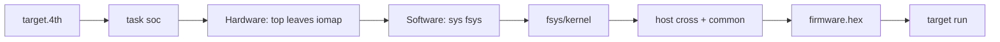

# Карта репозитория (fsoc)

English: [MAP-eng.md](MAP-eng.md).

Куда класть новый файл. Новый `cpu:`: [add-cpu.md](add-cpu.md). Вход человека: [README.md](../README.md), [CONTRIBUTING.md](../CONTRIBUTING.md).

```text
rtl/              Чистые Verilog-листы (blinky.v, timer.v, …)
designs/          Топы fhdlgen (без платы и пути проекта)
boards/           Такт, пины, семейство
targets/          Эмиттеры emulation / quartus / yosys / proteus
emu/              Общая консоль Verilator (pin / uart), без имён задач
cpu/<family>/     Soft-CPU Verilog-киты (j1, bcpu, mcpu, …)
fsys/fasm/<id>/   Только ассемблер
fsys/kernel/<id>/ Ядро консоли Forth
fsys/host/        Хостовый кросс для этого id
fsys/<id>/        extra / release
fsys/common/      Общий слой ANS (если кросс его загружает)
firmware/         Приложения (циклы 'BOOT, fasm-мигалки, mcpu_ping/pong)
fsoc/             IR сборщика, задачи (в т.ч. dual-mcpu), профили cpu/sys
projects/         Рабочие каталоги: baremetal/ | soc/ | standalone/; в git только target.4th
tests/            Наборы fmix / gforth
openspec/specs/   Требования
doc/              Заметки для человека (GLOSSARY, FMAP-INDEX, add-cpu, mcpu-pingpong, …)
```

Демо двух ядер: `cpu/mcpu/dual_pingpong.v` + `projects/baremetal/dual_mcpu_emul` — [mcpu-pingpong.md](mcpu-pingpong.md).

## Поток сборки (soc + fsys)



## Поля манифеста

```forth
s" soc" task:
s" emulation" target:
s" designs/soc_console.4th" design:
s" j1a" cpu:          \ опционально; пусто → j1a
s" fsys" sys:         \ обязательно для soc
s" lamp" s" 1" option:
```

## Правила покрытия fasm / ISA

**D1 — полнота по уровню ISA.** `fsys/fasm/<id>/words.4th` обязан содержать все инструкции архитектурного уровня. Инструкция, исключённая намеренно, помечается `intentional-absent` с причиной (например, «только в XMEGA», «нет на AT89C52»). «Экономия» не причина.

**D2 — подмножества через feature-gates.** Подмножественные синтезируемые ядра (AT1200-lite, j1abs без mul/div) описываются chip-profile + гейтами `isa-feat.4th` (`feat-define`, `have`, `need`). `words.4th` *не обрезается* под чип — гейты накладываются на полный spec.

**Golden-датасеты offline.** `tools/gen_golden.py` (avr-gcc, z80asm, sdas) → закоммиченный `tests/golden/`. В CI/`fmix test` — ноль внешних зависимостей. Поле `generator` фиксирует версию toolchain'а.
