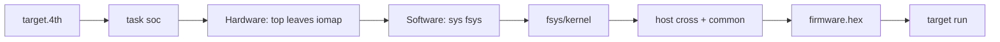

# Карта репозитория (fsoc)

Куда класть новый файл. Новый `cpu:`: `.cursor/rules/fsoc-cpu-target.mdc`. Вход человека: [README.md](../README.md), [CONTRIBUTING.md](../CONTRIBUTING.md).

```text
rtl/              Pure Verilog leaves (blinky.v, timer.v, …)
designs/          fhdlgen tops (no board, no project path)
boards/           Clock, pins, family
targets/          emulation / quartus / yosys / proteus emitters
emu/              Shared Verilator console (pin / uart), no task names
cpu/<family>/     Soft-CPU Verilog kits (j1, bcpu, mcpu, …)
fsys/fasm/<id>/   Assembler only
fsys/kernel/<id>/ Forth console kernel
fsys/host/        Host cross for that id
fsys/<id>/        extra / release
fsys/common/      Shared ANS layer (when the cross can load it)
firmware/         Apps ('BOOT loops, fasm blinks, mcpu_ping/pong)
fsoc/             Builder IR, tasks (incl. dual-mcpu), cpu/sys profiles
projects/*/       Working dirs; git keeps only target.4th
tests/            fmix / gforth suites
openspec/specs/   Requirements
doc/              Human notes (GLOSSARY, FMAP-INDEX, mcpu-pingpong, …)
```

Dual-core demo: `cpu/mcpu/dual_pingpong.v` + `projects/baremetal/dual_mcpu_emul` — [mcpu-pingpong.md](mcpu-pingpong.md).

## Build flow (soc + fsys)



## Manifest fields

```forth
s" soc" task:
s" emulation" target:
s" designs/soc_console.4th" design:
s" j1a" cpu:          \ optional; empty → j1a
s" fsys" sys:         \ required for soc
s" lamp" s" 1" option:
```
